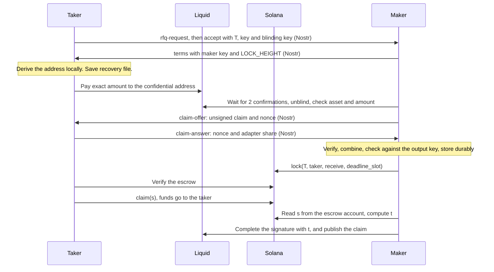
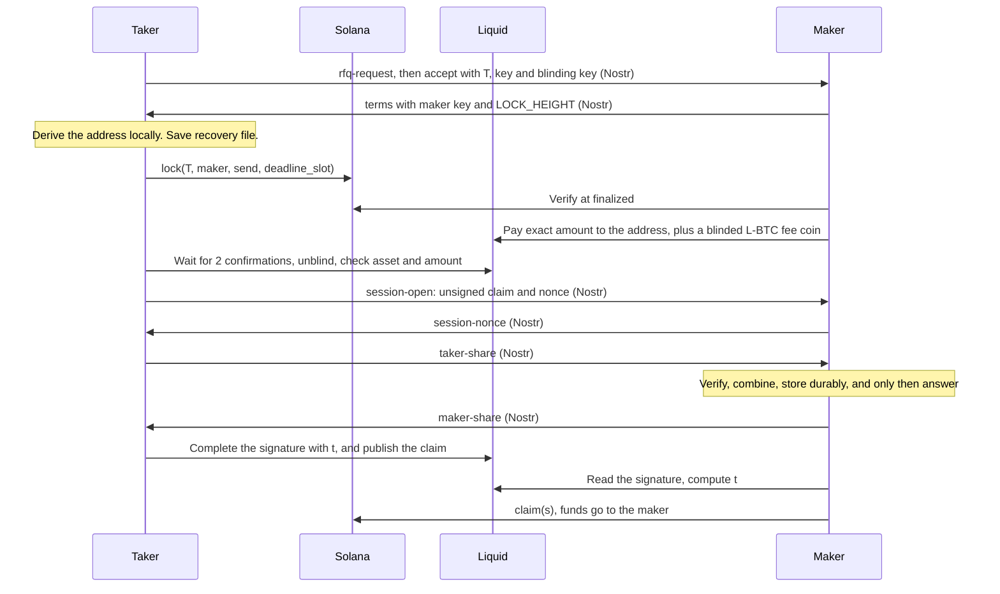

# Protocol

Status: the confidential design, from [confidential.md](confidential.md), which has the reasoning and the measurements.
Facts cited here are sourced in [assumptions.md](assumptions.md). Section 9 records the decisions the user made.

## 1. Trust model

- **Trustless between counterparties.** Neither party can take the other's funds under the assumptions below. Either
  party can recover its own funds without any server, relay or counterparty.
- **Accepted trust:**
  - Tether can freeze USDT on Solana. Whether it can freeze L-USDt is **UNVERIFIED**.
  - The Liquid federation controls Liquid consensus. It has halted the chain and has rolled it back (section 7).
  - Solana validators control Solana consensus.
- **Assumptions the safety argument needs**, each of which has failed or could fail in practice:
  - A confirmed Liquid transaction stays confirmed (section 7.3).
  - A Liquid halt doesn't outlast the protection in section 7.1.
  - A party that must act on-chain is online inside its window.
- **Non-goals:** wrapped assets, lock-and-mint bridges, multisig custody of user funds.

## 2. Parties and parameters

The taker always creates the secret and always locks first. The secret is a uniformly random scalar `t`, with point
`T = t·G`. Liquid sees neither. Solana locks to `T`, and a claim reveals `s = t·Gx mod n`, from which only someone already
holding `T` and the matching adapter signature gets anything useful. Test vectors that the program, the Rust code and an independent
calculation must agree on are in `contracts/swapkey/tests/values.rs`.

| Symbol | Meaning |
|---|---|
| `A_sol` | Amount in SOL-USDT base units (6 dp). This is the quoted value. |
| `A_liq` | `A_sol × 100`, in L-USDt base units (8 dp). Checked multiplication; overflow rejects the swap. |
| `h_accept` | Liquid tip height the maker records when accepting the RFQ. |
| `LOCK_HEIGHT` | Absolute Liquid refund height, a parameter of the refund leaf, so it is fixed before anyone funds. |
| `deadline_slot` | Solana slot at which the escrow's claim closes and refund opens. |

**Amounts.** Each side receives exactly the amount it agreed to, with no rounding anywhere. The quote is expressed
directly as the pair (`send`, `receive`), and the maker's spread comes from the difference. Liquid amounts must be
multiples of 100 base units; clients reject anything else. Each leg locks one exact amount, and the two legs of a swap
generally differ by the spread:

- L→S: taker locks `L = send` on Liquid, maker locks `receive` on Solana.
- S→L: taker locks `send` on Solana, maker locks `L = receive` on Liquid.

## 3. Timeouts

Live measurement (2026-11-05): 213 ms per slot on average over the last hour, range 208–220 ms. The nominal value is
now 200 ms, not the historical 400 ms. **Slot counts below assume 213 ms per slot.** Clients compute them from
`getRecentPerformanceSamples` when quoting and never from a hard-coded rate.

| Constant | Value | Purpose |
|---|---|---|
| `LIQ_CONFS` | 2 blocks | Minimum confirmations before reacting to a Liquid lock (the brief's value; see section 7.3) |
| `SOL_COMMITMENT` | `finalized` | Solana commitment for every state-changing decision |
| `FUND_WINDOW` | 30 blocks (L→S), 15 blocks (S→L) | Time for the taker to lock after the maker accepts |

**L→S** (taker's Liquid lock is long, maker's Solana lock is short):

| Parameter | Value | Wall time |
|---|---|---|
| `LOCK_HEIGHT` | `h_accept + 300` | about 5 h |
| `deadline_slot` | maker's lock slot `+ 8,400` | about 30 min |
| Maker lock gate | Lock only if `LOCK_HEIGHT − tip ≥ 210` | Guarantees the margin below |
| Taker claim cutoff | Do not reveal if `deadline_slot − slot < 600` | about 2 min |

Worst case for the maker: it locks at the gate with 210 blocks left, and 30 minutes of escrow time leaves
**at least 180 blocks (about 3 h)** to claim on Liquid after a last-moment reveal. Worst case for the taker: if the
maker never locks, funds are stuck for about 5 h, then refundable.

**S→L** (taker's Solana lock is long, maker's Liquid lock is short):

| Parameter | Value | Wall time |
|---|---|---|
| `LOCK_HEIGHT` | `h_accept + 90` | about 90 min |
| `deadline_slot` | taker's lock slot `+ 101,400` | about 6 h |
| Maker lock gate | Lock only if `tip ≤ h_accept + 30` and at least 84,500 slots remain (about 5 h) | |
| Taker claim cutoff | Do not reveal if `LOCK_HEIGHT − tip < 10` | about 10 min |

Worst case for the maker: at least **about 4 h** between `LOCK_HEIGHT` and the taker's refund opening (5 h of slots at
the gate, less at most 60 blocks), so a claim revealed at the last moment still leaves that long to claim on Solana. Worst case for the taker: about 6 h if the maker
never locks, and up to a further 7 days if the maker invokes `extend` (section 7.1).

**Why the short legs differ.** A Liquid claim needs a block (1 min) and an L-BTC fee, so it gets 60 blocks of usable
window at minimum. A Solana claim lands in seconds.

## 4. L-USDt → SOL-USDT

Keys: the taker holds a per-swap Liquid key, which can refund alone and claim only with the maker. The maker holds a per-swap Liquid
key and a Solana key. The taker's Solana wallet receives. The taker also generates the coin's blinding key, and shares it in the
encrypted accept.

### Taker states

| State | Do | Next |
|---|---|---|
| `QUOTED` | Validate terms, generate `t` and keys, derive the address | `RECOVERY_SAVED` |
| `RECOVERY_SAVED` | The funding address is hidden until the recovery file has been downloaded and read back | `AWAIT_FUNDING` |
| `AWAIT_FUNDING` | Watch the address and unblind what arrives. Wrong amount or asset → `REFUND_WAIT`, and warn the user that it can only be refunded | `SIGNING` |
| `SIGNING` | Answer the maker's claim offer: input 0 must be this swap's coin. The share is useless to the maker until `s` is public. | `AWAIT_MAKER` |
| `AWAIT_MAKER` | Read escrow PDA `(maker, T.x)` and verify recipient, mint, amount, point, deadline and bond | `CLAIMING`, or `REFUND_WAIT` once the maker can no longer lock |
| `CLAIMING` | Preflight, then send `claim(s)`. Check the cutoff first. | `DONE`, or `REFUND_WAIT` if never revealed |
| `REFUND_WAIT` | Wait for `LOCK_HEIGHT` | `REFUNDING` |
| `REFUNDING` | Ensure a blinded L-BTC fee coin exists, spend the coin through the refund leaf to the user's address. This is recognisable as a swap refund. | `REFUNDED` |

Before revealing the secret, in either direction, the client must:

1. **Confirm the counterparty's lock on two independent endpoints.** Sending `s` to a lying endpoint that colludes with
   the maker hands over the secret against a lock that doesn't exist, and the maker then takes the taker's funds. With
   only one endpoint configured, the client requires an explicit override with a warning.
2. **Simulate the claim** (Solana). The value in a failed transaction is public, and it lets the maker take the
   Liquid funds **while the taker receives nothing**. Skipping preflight is forbidden. See section 7.4 for frozen
   accounts.

### Maker states

| State | Do | Next |
|---|---|---|
| `ACCEPTED` | Record `T.x` (must never have been seen) and derive the expected address | `WATCH_LOCK` |
| `WATCH_LOCK` | Wait for an output at the address that unblinds to exactly the agreed asset and amount. Abandon if past `FUND_WINDOW` | `LOCK_GATE` |
| `LOCK_GATE` | Check confirmations, the gate in section 3, and halt detection (section 7.5). Run the signing session. **No lock without a stored adapter signature.** | `LOCKED`, or abandon |
| `LOCKED` | Poll the escrow account | `CLAIMED_SOL` on claim, `REFUND_SOL` once closed |
| `CLAIMED_SOL` | Read `s`, compute `t`, complete the stored signature, and publish. Rebroadcast until confirmed. The fee can't be raised, because the signature commits to the transaction. A child spend of the output can. | `DONE` |
| `REFUND_SOL` | Call `refund` | `DONE` |

## 5. SOL-USDT → L-USDt

Keys: the taker holds a per-swap Liquid key, and its wallet signs on Solana. The maker holds a per-swap Liquid key, which can refund
alone, and a Solana recipient key. `LOCK_HEIGHT` is fixed at accept, so the taker knows the Liquid address in advance and can find
the maker's lock with no message at all.

**The order inside the session is what keeps the maker safe.** With the maker's share the taker can finish the claim, and the maker
can only read `t` from that signature if it holds the matching adapter signature. So the maker stores it first, gives one share
per swap, and resends the same share if the reply was lost. It also refuses once the taker's escrow is no longer open.

### Taker states

| State | Do | Next |
|---|---|---|
| `QUOTED` | As in section 4 | `RECOVERY_SAVED` |
| `RECOVERY_SAVED` | As in section 4 | `LOCKING` |
| `LOCKING` | Wallet signs `lock`. Check `FUND_WINDOW` first. | `AWAIT_MAKER` |
| `AWAIT_MAKER` | Watch the address and unblind what arrives, for the exact asset and amount with enough confirmations | `SIGNING`, or `REFUND_WAIT` once the maker can no longer lock |
| `SIGNING` | Run the session. If the maker never answers, nothing has been revealed, and the swap ends in `REFUND_WAIT`. | `CLAIMING` |
| `CLAIMING` | Check the cutoff and two-endpoint confirmation (section 4), complete the signature, and publish. Rebroadcast until confirmed. | `DONE` |
| `REFUND_WAIT` | Wait for `deadline_slot`, which `extend` may have moved | `REFUNDING` |
| `REFUNDING` | Wallet signs `refund`. **Never** publish the Liquid claim after this. | `REFUNDED` |

After the taker broadcasts a Liquid claim the maker can read the secret, so the client must keep rebroadcasting until
confirmed. If the maker's refund beats it (only possible if the cutoff was ignored or Liquid rolled back), the taker has
lost the funds.

### Maker states

| State | Do | Next |
|---|---|---|
| `ACCEPTED` | Record `T.x` | `WATCH_LOCK` |
| `WATCH_LOCK` | Read escrow PDA `(taker, T.x)` at `finalized`, verify all fields including the full point and `close_on_restart = false` | `LOCK_GATE` |
| `LOCK_GATE` | Gate from section 3, exposure limits, halt detection | `LOCKED`, or abandon |
| `LOCKED` | Take part in the session when asked. Watch the coin's outpoint, mempool included | `CLAIMED_LIQ` on spend, `REFUND_LIQ` at `LOCK_HEIGHT` |
| `CLAIMED_LIQ` | Read `t` from the signature, using the stored adapter signature. Claim on Solana at once | `DONE` |
| `REFUND_LIQ` | Broadcast as soon as the tip reaches `LOCK_HEIGHT`, so it mines in the first block that allows it, racing any late taker claim. Refused if this swap's Solana escrow is `Claimed` (section 7.3). | `DONE` |

## 6. Message formats

Off-chain messages are defined in [nostr-rfq.md](nostr-rfq.md), and contract parameters in [contracts.md](contracts.md).
After `terms`, **no further message is needed to complete or to refund**: every later step reads the chains, because all
addresses and PDAs are derived from data both sides already hold.

## 7. Failure behaviour

Sources for the incidents are in [assumptions.md](assumptions.md) section 10.

### 7.1 Liquid halt

The September 2026 incident stopped user transactions for about 4 days (exploit Sept 6, user transactions again from
Sept 10). An earlier halt lasted about 22 hours.

| Direction and stage | Effect | Result |
|---|---|---|
| L→S, any stage | The Liquid clock stops, so `LOCK_HEIGHT` can't pass. The maker claims when blocks resume. | Safe. Delayed. |
| S→L, taker locked, maker not yet | Maker's gate fails, taker refunds at `deadline_slot`. | Safe. |
| S→L, both locked, honest taker | Taker's claim waits for Liquid. | Safe unless the refund opens first; see below. |
| **S→L, both locked, malicious taker** | **Solana's clock keeps running. The taker refunds on Solana at `deadline_slot`, then claims on Liquid when blocks resume, before `LOCK_HEIGHT`. The maker loses the amount.** | **Theft, without mitigation.** |

Liquid can't help here: a Simplicity program can only assert that the transaction's lock time is at least a value, so
it can't express "before height X". The claim path therefore can't be closed by height.

**Mitigation (D1):** an `extend` instruction lets the recipient of a long-leg escrow push `deadline_slot` later, once,
by at most about 7 days, and only before it passes. The maker's daemon calls it when Liquid has stalled while S→L swaps
are open. It can't take funds, only delay them. A maker who abuses it is provably visible on-chain, since anyone can
check that Liquid was not halted at that moment. Halts beyond the extension remain a residual risk, bounded by the
maker's exposure cap.

### 7.2 Solana halt

| Direction and stage | Effect | Result |
|---|---|---|
| S→L, any stage | Slots pause, so `deadline_slot` doesn't pass. The maker claims after restart. | Safe. Delayed. |
| **L→S, both locked** | **Liquid's clock keeps running. If `LOCK_HEIGHT` passes during the halt, the taker refunds on Liquid and, after restart, claims on Solana while slots remain. The maker loses the amount.** | **Theft, without mitigation.** |

**Mitigation:** short-leg escrows set `close_on_restart = true`. If `LastRestartSlot` is greater than the escrow's
creation slot, claim closes and refund opens immediately. Anyone whose claim hadn't landed before the restart refunds
through the normal path.

The remaining cases:

- **Stall with no hard fork.** `LastRestartSlot` only changes on a hard-fork restart. A stall that recovers on its own
  and lasts longer than the 3 h margin is not caught. How slots behave in such a stall under Alpenglow is **UNVERIFIED**.
- **Taker revealed just before the restart.** If an unconfirmed claim leaked `p` and the restart then closes the escrow,
  the maker could take both legs. This needs the restart to fall in the seconds between send and landing, and a leak
  from the transaction's route.

**Why not `unix_timestamp`?** An earlier draft used slots because the timestamp could jump forward after a restart.
That reasoning is out of date. Under Alpenglow the leader sets the timestamp, limited to
`(parent, parent + 2 × elapsed slot duration]`, so it can't jump: after a halt it catches up at no more than twice real
time. It has no meaningful lower bound either, and each leader chooses it. Slots remain the right clock, but
`unix_timestamp` would not have closed the L→S hole, which is why the design uses `LastRestartSlot`.

### 7.3 Reorgs and rollbacks

- **Liquid.** Blocks are signed, so ordinary reorgs are not expected, and "final after 2 blocks" is the working rule.
  But **the federation rolled the chain back in September 2026**: it replaced block 4,050,336 and replayed verified
  transactions. Depth and replay coverage aren't stated in the post-mortem (**UNVERIFIED**).
  - L→S: a rollback that drops the taker's lock after the maker has locked lets the taker claim on Solana and then
    double-spend its Liquid inputs. The maker loses the amount.
  - S→L: a rollback that drops the taker's claim leaves the coin unspent, after the maker has already claimed on Solana.
    The claim has no height limit, so the taker recovers by rebroadcasting it. **An honest maker that has claimed on
    Solana must never refund that coin**, even past `LOCK_HEIGHT`, which leaves the taker able to collect whenever it
    returns. A dishonest maker can still refund after `LOCK_HEIGHT` and keep both sides, so the taker must rebroadcast
    promptly.
  - These can't be fully mitigated by a contract. They are accepted federation trust, bounded by exposure caps (D7).
- **Solana.** Act only at `finalized`. The exception is the taker's send of `claim`, which must leave the cutoff margin.

### 7.4 Tether freezes

| What is frozen | Effect | Behaviour |
|---|---|---|
| Taker's token account, L→S | `claim` fails, and sending it would reveal `p`. | Preflight detects it, and the client doesn't reveal. Taker refunds on Liquid at `LOCK_HEIGHT`. Maker refunds on Solana. No loss. |
| Maker's token account, S→L | The maker can't claim after the taker has revealed. | The maker loses the amount unless it is unfrozen before the deadline, so the maker checks this at the gate. A freeze in the window is residual risk. |
| Escrow token account | Claim and refund both fail. State doesn't change. | Funds are stuck until unfrozen; retry afterwards. If this hits after a reveal, the maker takes the loss. |
| L-USDt | **UNVERIFIED** whether possible. No consensus mechanism for it was found in the Elements code read so far. | Treated as a stuck-funds risk, like the row above. |

Each swap has its own token account, so a freeze affects one swap only. The optional maker vault (D6) is a single
freezable account and an exception to this; see [contracts.md](contracts.md).

### 7.5 Other failures

| Failure | Behaviour |
|---|---|
| Maker offline before locking | The taker refunds after the timeout. It costs the taker time only. |
| Maker offline after the taker's reveal | Maker's own risk. Its margin is the 3 h or 4 h above. Watchtowers can call the permissionless Solana claim. |
| Taker offline after locking | No loss. The taker refunds whenever it returns, or a watchtower does. |
| Taker loses browser state | The recovery file alone is enough to refund or finish the swap. |
| Relay failure | Quotes and new swaps stop. An open swap that hasn't finished its signing session can't complete, and ends in refunds with nothing lost. Once the session is over, relays no longer matter. |
| Explorer or RPC failure | Endpoints are user-configurable. Delay only, as long as it is shorter than the margin. |
| Wrong amount or asset sent | **Nothing on-chain refuses it.** Neither party signs a claim of a coin that isn't exact, so only the refund path is used, and the sender recovers it at `LOCK_HEIGHT`. |
| Two payments to one swap address | Each is a separate coin. The maker acts on one exact coin. The other is refundable at `LOCK_HEIGHT`. |
| Halt detection (maker) | Stop new locks if the Liquid tip is older than 10 min or Solana's finalized slot stops moving for 60 s. |

## 7.6 Privacy

**An outside observer can't link the two legs, and can't see the Liquid amount or asset.** Each measure and its limits are in
[confidential.md](confidential.md).

| Who can see | What |
|---|---|
| Anyone reading Liquid | A taproot spend of a blinded coin, paying a blinded output, like any other. A claim shows one signature and no script. **A refund is recognisable:** it reveals a Simplicity leaf with a lock height. The L-BTC fee is public. |
| Anyone reading Solana | The escrow, both parties' addresses, the amount, the point `T` and the revealed value. The Solana leg isn't private. |
| Anyone reading both | **No shared value.** `T` and `t` appear nowhere on Liquid. Only timing could suggest a link, and the amount can't, because it is hidden. |
| The counterparty | Everything about this swap: the blinding key reads the amount, and it knows both legs. |
| Relays | Who receives a message and when. Not its contents, or who sent it. |

The hidden amount holds only if the coins around it are blinded. A wallet spending explicit coins gives a bound on what it paid, so
the maker's wallet holds only blinded coins. A taker paying from an explicit coin leaks that bound for its own swap.

## 8. Free option and griefing

USDt and USDT are the same issuer's token, so the free option in the usual sense is close to worthless unless one side
depegs. The real costs are:

- **Taker griefs maker:** ties up the maker's capital for 30–90 minutes per swap. The attacker's own funds are locked
  for longer than the maker's in both directions, so this attack costs more capital than it denies, but the attacker
  pays almost nothing else (Liquid fees are about 0.1 sat/vB).
- **Maker griefs taker:** ties up the taker's funds for 5–6 h. There is no on-chain remedy without the Phase 2 light
  client, so reputation carries the load.

See D2 for the options.

## 9. Decisions

The user accepted all ten recommended options on 2026-11-05. The alternatives stay listed as a record of the trade-offs.

### D1. Liquid halt during S→L

| Option | Trade-off |
|---|---|
| **`extend` instruction (accepted)** | Closes the theft for halts up to 7 days. About 15 lines of program code. A malicious maker can delay a taker's refund by up to 7 days, though not steal it. |
| Longer margin only | No new instruction. Covering a 4-day halt means 4-day refunds in every no-show. |
| Accept the risk with exposure caps | Simplest. A maker can lose its open S→L exposure in a long halt. |

### D2. Free option and griefing

| Option | Trade-off |
|---|---|
| **No bond in v1: spread, short timeouts, per-key rate limits, reputation (accepted)** | Simplest and best UX. Griefers lose capital time only. |
| Add the L→S bond (lamports, forfeited if the taker doesn't claim) | Enforceable on-chain. Adds three instructions and a pre-funding step, and penalizes takers who merely went offline. Specified in [contracts.md](contracts.md) as an optional module. |
| S→L bond | Not trustlessly enforceable: Solana can't see whether the maker locked on Liquid. Either the maker can take it unfairly or it can never be enforced. Only sensible after Phase 2. |

### D3. L-BTC for Liquid fees

Non-L-BTC fees aren't usable: consensus tracks fees per asset, but the mempool counts only the policy asset, so a
USDt-only fee counts as zero and fails relay. This decision still holds under the confidential design, with the fee coin now blinded, and a
reserved pool on the maker's side ([confidential.md](confidential.md)).

| Option | Trade-off |
|---|---|
| **Maker adds an L-BTC "fee coin" to the taker's key in S→L; taker funds its own for L→S refunds, only if a refund is needed (accepted)** | No contract change. Costs the maker a few hundred sats per swap, priced in. A taker with no L-BTC needs to acquire a small amount in order to refund L→S. |
| Taker must always hold L-BTC | Simplest, but many USDt-only wallet users have none, so S→L fails for them. |
| Covenant allows `output 0 ≥ AMOUNT − SPONSOR_CAP`, so a third party can add L-BTC and be paid in USDt | Solves the no-L-BTC case fully, with a slightly larger covenant and an inexact amount. Needs a sponsor to exist, which reintroduces infrastructure. |

### D4. Recipient signature on the claim

*Superseded by the confidential design: a claim is now one key-path signature from both parties, and there is no covenant.*

| Option | Trade-off |
|---|---|
| **Keep the signature and the covenant (accepted, matches the brief)** | Defense in depth. A watchtower needs a pre-signed claim, and pre-signing needs the fee input known in advance. |
| Covenant only, no signature | Anyone with `p` can claim to the fixed script, which makes watchtowers trivial and the contract smaller. Needs an extra rule so that two coins at one address can't be merged into one output, and mempool watchers can front-run the fee input. |

### D5. Taker has no SOL (L→S)

The claim needs a transaction fee, and the token account needs rent if it doesn't exist yet.

| Option | Trade-off |
|---|---|
| **Require a small SOL balance, checked before funding (accepted)** | Simple and trustless. Excludes wallets with no SOL. |
| Relayer-paid claim, with a tip from the amount | Better UX. The program gets a tip parameter and someone must run relayers, though no trust is needed since claim is permissionless. |
| Handing the secret to the maker to claim for the taker | **Rejected: unsafe.** The maker could claim on Liquid and let the escrow expire. |

### D6. Maker deposits and taker reservations

The brief lists both. A reservation can't be enforced in Phase 1, because Solana can't see the Liquid lock.

| Option | Trade-off |
|---|---|
| **Vault with hot-key rate cap now, reservations in Phase 2 (accepted)** | Caps what a stolen hot key can drain per window, and shows liquidity publicly. Adds about five instructions. Departs from the brief on reservations, since the signed `terms` message is only an off-chain reservation. |
| Neither in v1 | Smallest program. The maker's hot key holds everything it can spend. |
| Both now | Reservations would rest on a taker bond, with the same limits as D2. |

### D7. Liquid confirmation depth

| Option | Trade-off |
|---|---|
| **2 blocks up to a per-swap limit, 10 blocks above it, plus a total exposure cap (accepted)** | Reduces rollback exposure for larger swaps at a small cost in speed. The September rollback shows depth doesn't remove the risk, so the cap carries the weight. |
| 2 blocks always | The brief's value. Fastest. |

### D8. Program upgradeability

| Option | Trade-off |
|---|---|
| **Devnet upgradeable, mainnet immutable (accepted)** | Users needn't trust an upgrade key. A bug means deploying a new program and migrating. |
| Upgradeable under a timelock or multisig | Bugs can be patched, but an upgrade authority is a trusted party, which the brief is trying to avoid. |

### D9. Rebalancing

The brief asks the daemon to rebalance. Every venue adds trust and puts a key on the host.

| Option | Trade-off |
|---|---|
| **v1 adjusts spreads, stops quoting and alerts; moving funds stays manual (accepted)** | No new secrets on the hot host. Departs from the brief, and needs more operator attention. |
| Automate through other liq2sol makers | No new secrets, but needs a working maker market first. Possible later. |
| Automate through an exchange API | Most hands-off. Adds an exchange key and an exchange account's custody risk, which is the attack surface this project is trying to reduce. |

### D10. Recovery file encryption

| Option | Trade-off |
|---|---|
| **Optional passphrase, off by default (accepted)** | Fewer funds lost to forgotten passphrases. A leaked unencrypted file can spend open swaps. |
| Required passphrase | A leaked file is safe. A forgotten passphrase loses funds if browser state is also gone. |

## 10. Watchtowers (optional)

- **Solana claim is permissionless.** Anyone with `p` can call it, and funds can only go to the fixed recipient. A maker
  can use a watchtower freely, since `p` is already public by then. A taker giving a watchtower `p` before claiming must
  trust it: if `p` leaks to the maker and the claim doesn't land, the taker loses the swap.
- **Liquid refund.** A taker can pre-sign the refund (its `sig_all_hash` fixes all outputs and inputs, including a
  pre-existing fee coin), and hand it to a watchtower that broadcasts it after `LOCK_HEIGHT`. The watchtower can't
  redirect funds. Its only power is to broadcast early, which fails, or not at all.
- **Solana refund.** Permissionless: funds can only go back to the initiator.
- No watchtower ever needs custody. All of this is optional and off by default.

## 11. Phase 2 extension: Liquid light client (design only)

Goal: a Solana program that verifies a Liquid transaction, so a maker can reserve liquidity against a taker who pays the
maker's registered Liquid address directly, with no swap lock on Liquid and no taker secret.

- **Header format** (checked by decoding live mainnet block 4,131,983): dynafed version bit, a compact current params
  entry holding the P2WSH signblockscript and an elided root, and a witness stack of 13 items: empty dummy, 11 DER ECDSA
  signatures with sighash byte `01`, and a 513-byte witness script `OP_11 <15 keys> OP_15 OP_CHECKMULTISIG`. The hash of
  that script matches the signblockscript.
- **Cost.** Verifying 11 signatures against an ordered key list with `sol_secp256k1_recover` at 25,000 CU each needs
  two attempts per signature at worst, about 550,000 CU, plus hashing. That fits the 1.4M CU transaction limit. The
  513-byte script and 11 signatures also have to fit a 1,232-byte transaction, which is tight once accounts are added,
  so the proof likely spans a buffer account.
- **Key rotation.** Dynafed epochs are 20,160 blocks, with two valid epochs at a time. The light client tracks the
  active signblockscript and accepts a change only when signed under the previous one.
- **Inclusion.** Merkle proof of the transaction against the header's merkle root.
- **Rollback.** A rollback like September's would invalidate a proven transaction, and the program can't know. It needs
  a depth requirement, and it inherits the federation trust the rest of this design documents.
- **Exact sighash and header-hash details are UNVERIFIED** and need a test against real headers before any build.
